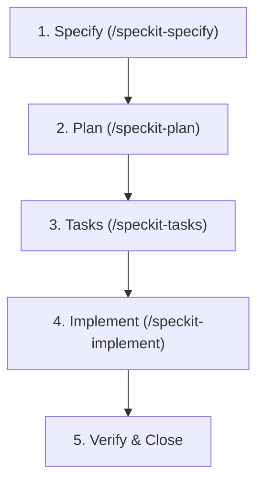

# GitHub Spec Kit Master Toolkit (/speckit)

Use this skill to guide and execute the complete Spec-Driven Development (SDD) cycle for any feature in Safedeal / EscrowSocial.

## The 4 SDD Milestones

### 1. Specification (`specs/<id>/spec.md`)
- Defines **WHAT** and **WHY** without jumping straight to code.
- Captures acceptance criteria, personas, and testable requirements.

### 2. Technical Plan (`specs/<id>/plan.md`)
- Defines **HOW** the architecture satisfies the spec.
- Selects framework primitives, data schemas, API contracts, and component trees.

### 3. Task Breakdown (`specs/<id>/tasks.md`)
- Granular, ordered execution checklist.
- Each task is atomic, testable, and references specific files.

### 4. Implementation & Verification
- Executes tasks sequentially using test-driven verification.
- Validates the resulting user experience against the acceptance criteria.
